# LAB 4 – Khảo sát và đánh giá bề mặt mạng bằng Nmap

Báo cáo thực hành môn **An toàn hệ thống thông tin** – Bộ môn An toàn Thông tin.

## Thông tin sinh viên

| Thông tin | Nội dung |
| :-- | :-- |
| Họ và tên | Huỳnh Hữu Hoàng |
| MSSV | 1150080095 |
| Lớp | 11CNPM2 |
| Giảng viên | Phạm Trọng Huynh |
| Ngày thực hiện | 29/09/2026 |
| File báo cáo | [1150080095_HuynhHuuHoang_11CNPM2_BAOCAO_Word.docx](1150080095_HuynhHuuHoang_11CNPM2_BAOCAO_Word.docx) |
| Video thực hành | https://youtu.be/Y19vLefHHtg |

## Video thực hành

[](https://youtu.be/Y19vLefHHtg)

Xem trên YouTube: [https://youtu.be/Y19vLefHHtg](https://youtu.be/Y19vLefHHtg)

## Mục lục

1. [Mục tiêu bài lab](#1-mục-tiêu-bài-lab)
2. [Môi trường thực hành](#2-môi-trường-thực-hành)
3. [Tóm tắt kết quả](#3-tóm-tắt-kết-quả)
4. [Quá trình thực hiện và ảnh minh chứng](#4-quá-trình-thực-hiện-và-ảnh-minh-chứng)
   - [4.1. Cài đặt Nmap trên Windows 11](#41-cài-đặt-nmap-trên-windows-11)
   - [4.2. Cài đặt Nmap và Zenmap trên Kali Linux](#42-cài-đặt-nmap-và-zenmap-trên-kali-linux)
   - [4.3. Dựng môi trường máy ảo Host-only](#43-dựng-môi-trường-máy-ảo-host-only)
   - [4.4. Lấy IP từng máy và kiểm tra kết nối](#44-lấy-ip-từng-máy-và-kiểm-tra-kết-nối)
   - [4.5. Phát hiện host đang hoạt động](#45-phát-hiện-host-đang-hoạt-động)
   - [4.6. Quét cổng TCP: -sT, -sS, -sF, -sA](#46-quét-cổng-tcp--st--ss--sf--sa)
   - [4.7. Quét UDP 20 cổng phổ biến](#47-quét-udp-20-cổng-phổ-biến)
   - [4.8. Nhận diện dịch vụ, hệ điều hành, NSE và xuất kết quả](#48-nhận-diện-dịch-vụ-hệ-điều-hành-nse-và-xuất-kết-quả)
5. [Đánh giá rủi ro và khuyến nghị](#5-đánh-giá-rủi-ro-và-khuyến-nghị)
6. [Trả lời câu hỏi phân tích](#6-trả-lời-câu-hỏi-phân-tích)
7. [Mức độ hoàn thành](#7-mức-độ-hoàn-thành)
8. [Cấu trúc thư mục](#8-cấu-trúc-thư-mục)
9. [Ghi chú](#9-ghi-chú)

## 1. Mục tiêu bài lab

- Cài đặt và kiểm tra Nmap trên Windows 11 (kèm Npcap, Zenmap) và Kali Linux.
- Dựng mạng máy ảo Host-only an toàn, xác định đúng IP của máy quét và máy đích.
- Thực hiện host discovery, quét TCP (-sT, -sS, -sF, -sA), quét UDP, nhận diện dịch vụ (-sV), hệ điều hành (-O) và chạy NSE script kiểm tra SMB.
- Đọc và giải thích các trạng thái open / closed / filtered / unfiltered / open|filtered.
- Xuất kết quả (-oN, -oX, -oG, HTML) để làm hồ sơ bằng chứng, đánh giá rủi ro và đề xuất biện pháp phòng thủ.

## 2. Môi trường thực hành

| Thành phần | Thực tế |
| :-- | :-- |
| Máy thật | Windows 11 Home 64-bit, RAM ≈ 8 GB; Nmap 7.991 + Npcap 1.89 |
| Ảo hóa | VMware Workstation; mạng **VMnet1 – Host-only 192.168.56.0/24** (thay cho “VirtualBox Host-Only Network” trong tài liệu) |
| Máy quét | Kali Linux 2026.2 – 192.168.56.129 – Nmap 7.99 |
| Máy đích | Metasploitable 2 – 192.168.56.130 |
| An toàn | Chỉ dùng Host-only, không Bridged; NAT của Kali chỉ bật tạm để cập nhật gói rồi gỡ; snapshot “Before-LAB4” cho cả hai VM |

```
                Windows 11 Host – 192.168.56.1
                          │
             VMnet1 – Host-only 192.168.56.0/24
         ┌────────────────┼─────────────────────┐
   Kali Linux      Metasploitable 2        VMware DHCP
 192.168.56.129     192.168.56.130        192.168.56.254
   (máy quét)         (máy đích)
```

## 3. Tóm tắt kết quả

| Mục | Lệnh chính | Kết quả | Minh chứng |
| :-- | :-- | :-- | :-- |
| Cài Nmap Windows | `nmap --version` | Nmap 7.991, Npcap 1.89, đã có trong PATH | Hình 2.1 |
| Cài Nmap Kali | `sudo apt install nmap` | Nmap 7.99 (bản mới nhất trong kali-rolling) | Hình 3.1 – 3.4 |
| Môi trường | Virtual Network Editor | VMnet1 Host-only 192.168.56.0/24; Kali .129, Metasploitable 2 .130; ping 0% loss | Hình 4.1a – 4.4 |
| Host discovery | `sudo nmap -sn 192.168.56.0/24` | 4 host up: .1 (máy thật), .129 (Kali), .130 (Metasploitable 2), .254 (DHCP của VMware) | Hình 5.0 – 5.1b |
| TCP Connect | `nmap -sT 192.168.56.130` | 23 open / 977 closed / 0 filtered – 4.74 s | Hình 6.1 |
| SYN scan | `sudo nmap -sS 192.168.56.130` | 23 open / 977 closed / 0 filtered – 4.77 s; không có sudo thì bị từ chối | Hình 6.2a, 6.2 |
| FIN scan | `sudo nmap -sF --reason 192.168.56.130` | 23 open\|filtered (no-response), 977 closed (reset) | Hình 6.3 |
| ACK scan | `sudo nmap -sA 192.168.56.130` | 1000 unfiltered → không có firewall giữa Kali và máy đích | Hình 6.6 |
| UDP scan | `sudo nmap -sU --top-ports 20 --reason 192.168.56.130` | 53/udp và 137/udp open; 3 open\|filtered; 15 closed | Hình 7.1, 7.1b |
| -sV, -O, -A, NSE, xuất kết quả | xem mục 4.8 | Phân tích trong báo cáo | Không có ảnh chụp |

## 4. Quá trình thực hiện và ảnh minh chứng

Mỗi bước dưới đây ghi lại lệnh đã gõ, kết quả quan sát được và ảnh chụp màn hình tương ứng. Số hình trùng với số hình trong file báo cáo Word.

### 4.1. Cài đặt Nmap trên Windows 11

**Thực hiện** (mục 2 trong báo cáo):

- Tải bản *Latest stable release self-installer* từ trang chính thức nmap.org, chạy bằng quyền Administrator, cài kèm Npcap và Zenmap.
- Mở PowerShell quyền Administrator, chạy `nmap --version`.
- Chạy `ipconfig` để tìm adapter Host-only dùng cho bài lab.

**Kết quả:**

- Nmap version **7.991**, Platform `i686-pc-windows-windows`; dòng *Compiled with* có **Npcap-1.89** → Npcap đã cài, Nmap gửi/bắt được gói tin thô. Lệnh chạy được ngay từ `C:\Users\USER` nên Nmap đã được đăng ký vào PATH.
- Vì dùng VMware nên adapter tương ứng “VirtualBox Host-Only Network” là **VMware Network Adapter VMnet1**: IPv4 `192.168.56.1`, mask `255.255.255.0`, không có Default Gateway (mạng Host-only không ra Internet). Các adapter khác (VMnet8 – NAT 192.168.25.1, VMnet2 – 172.16.16.1, Wi-Fi) không dùng để quét.

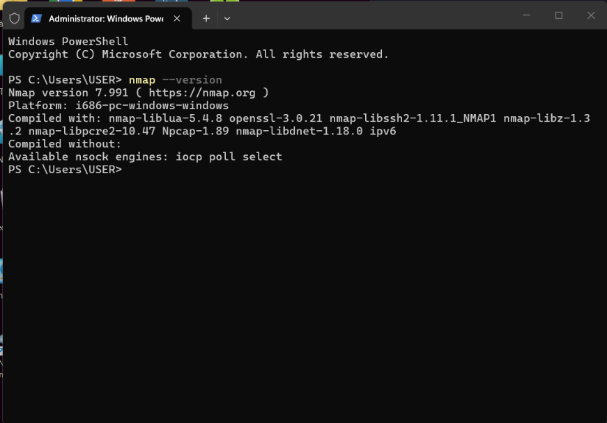

*Hình 2.1 – `nmap --version` trên Windows PowerShell (Administrator): Nmap 7.991, Npcap 1.89.*

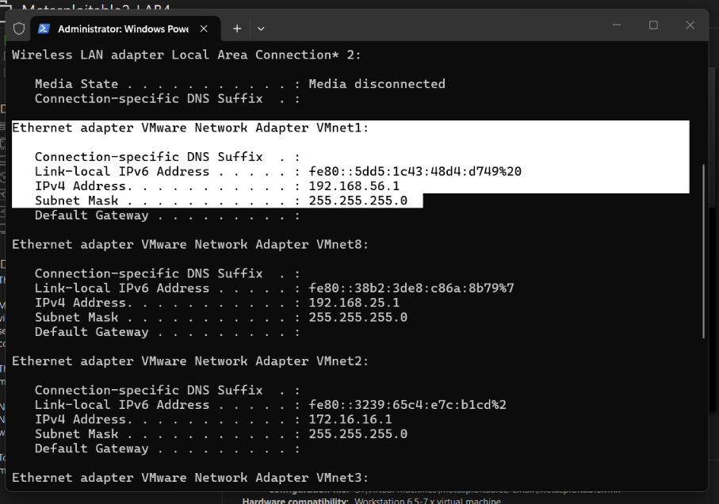

*Hình 2.2 – `ipconfig` trên Windows, phần bôi trắng là adapter VMnet1 (Host-only) 192.168.56.1/24.*

### 4.2. Cài đặt Nmap và Zenmap trên Kali Linux

**Thực hiện** (mục 3 trong báo cáo):

```bash
sudo apt update
sudo apt install nmap
nmap --version
sudo apt install zenmap
zenmap &
```

Trong lúc cài gói, Kali được bật tạm adapter NAT để ra Internet. Cài xong thì tắt Kali, gỡ adapter NAT, chỉ giữ Host-only (xem Hình 4.1b).

**Kết quả:**

- `sudo apt update` tải 77.1 MB danh sách gói từ kho kali-rolling, báo 1386 gói có thể nâng cấp.
- `sudo apt install nmap` báo *nmap is already the newest version (7.99+dfsg-1kali1)* → Kali có sẵn Nmap.
- `nmap --version`: Nmap **7.99**, Platform `x86_64-pc-linux-gnu`, biên dịch với libpcap-1.10.6 (tương đương Npcap trên Windows), openssl-3.6.2.
- Zenmap đã là bản mới nhất, lệnh `zenmap &` mở được cửa sổ Zenmap. Các dòng *DeprecationWarning* trong Terminal chỉ là cảnh báo thư viện Python/GTK cũ, không phải lỗi.

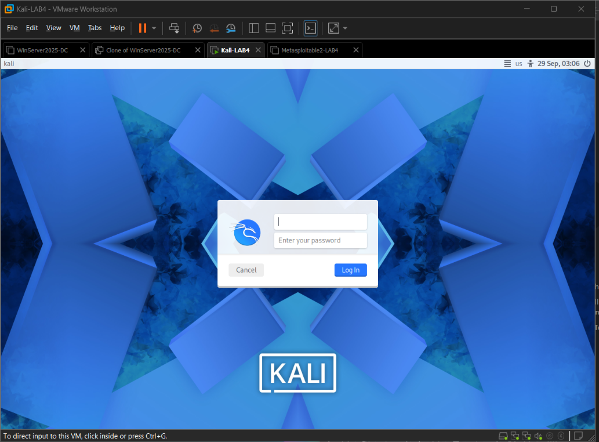

*Hình 3.0 – Khởi động máy ảo Kali-LAB4, đăng nhập tài khoản kali.*

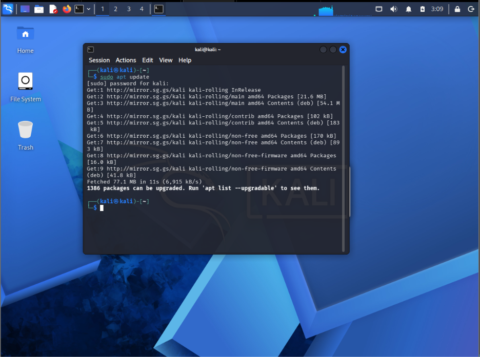

*Hình 3.1 – `sudo apt update`: tải danh sách gói từ kho kali-rolling.*

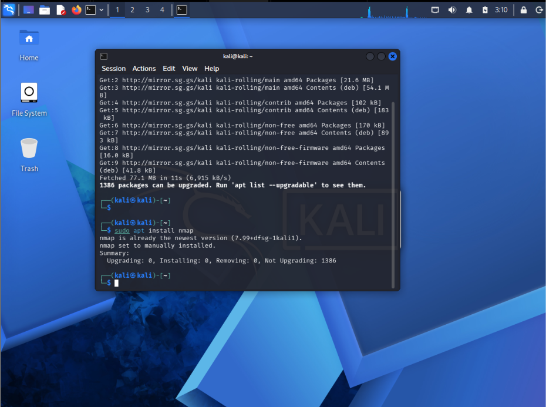

*Hình 3.2 – `sudo apt install nmap`: nmap is already the newest version (7.99+dfsg-1kali1).*

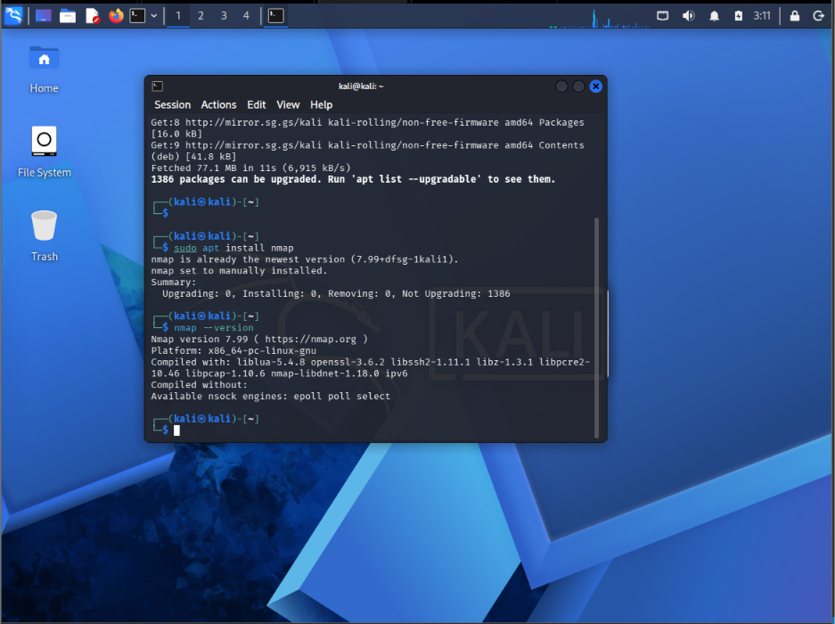

*Hình 3.3 – `nmap --version` trên Kali: Nmap 7.99, libpcap-1.10.6.*

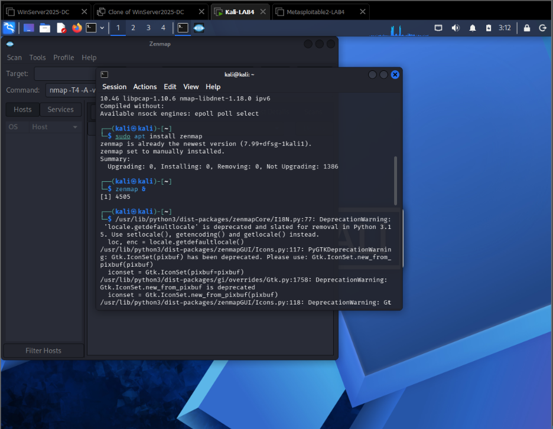

*Hình 3.4 – Cài và mở Zenmap trên Kali.*

### 4.3. Dựng môi trường máy ảo Host-only

**Thực hiện** (mục 4.1 trong báo cáo, làm trên VMware tương đương các bước 17–22 của tài liệu VirtualBox):

1. *Edit → Virtual Network Editor*: VMnet1 kiểu **Host-only**, Subnet IP `192.168.56.0`, mask `255.255.255.0`, bật *Use local DHCP service*, có host virtual adapter *VMware Network Adapter VMnet1*.
2. Kali-LAB4: chỉ còn **1 Network Adapter = Host-only** (đã gỡ NAT sau khi cập nhật gói).
3. Metasploitable2-LAB4: chỉ có **1 Network Adapter = Host-only**, không bao giờ Bridged vào mạng thật.
4. Tạo snapshot **“Before-LAB4”** cho cả hai máy ảo trước khi quét.

**Kết quả:** cả hai VM chỉ nối vào VMnet1 – mạng riêng giữa máy thật và các VM, không ra Internet. Có snapshot để khôi phục nếu môi trường bị hỏng. DHCP của VMware cấp IP trong dải .128 – .254 nên IP thực tế (.129, .130) khác sơ đồ mẫu (.10, .101).

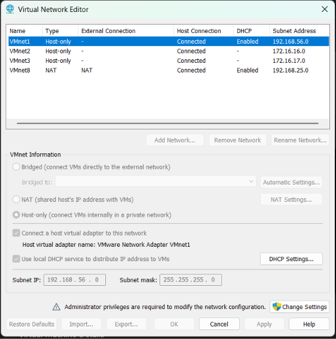

*Hình 4.1a – Virtual Network Editor: VMnet1 Host-only 192.168.56.0/24, bật DHCP.*

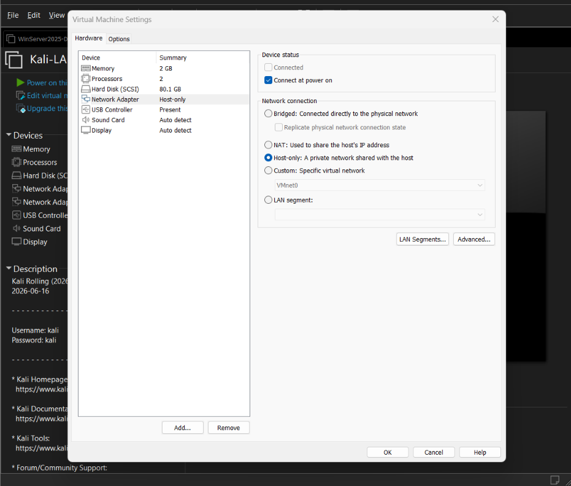

*Hình 4.1b – Kali-LAB4 chỉ còn 1 Network Adapter = Host-only.*

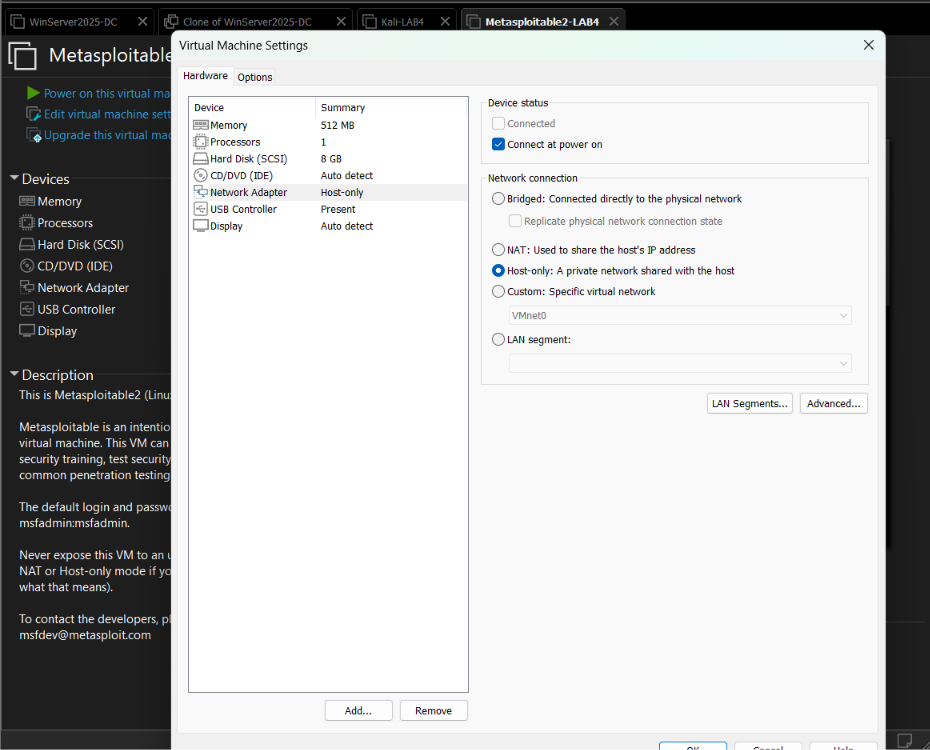

*Hình 4.1c – Metasploitable2-LAB4 chỉ có 1 Network Adapter = Host-only, không Bridged.*

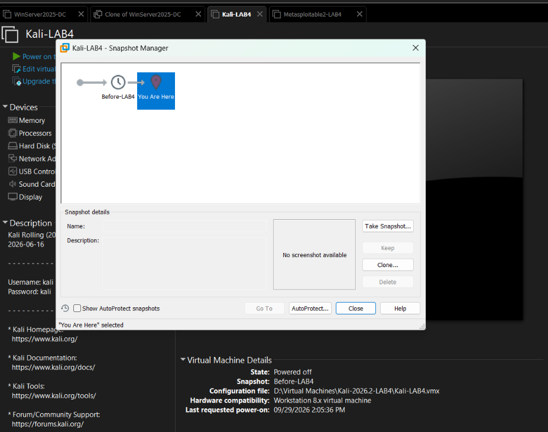

*Hình 4.1d – Snapshot “Before-LAB4” của Kali-LAB4.*

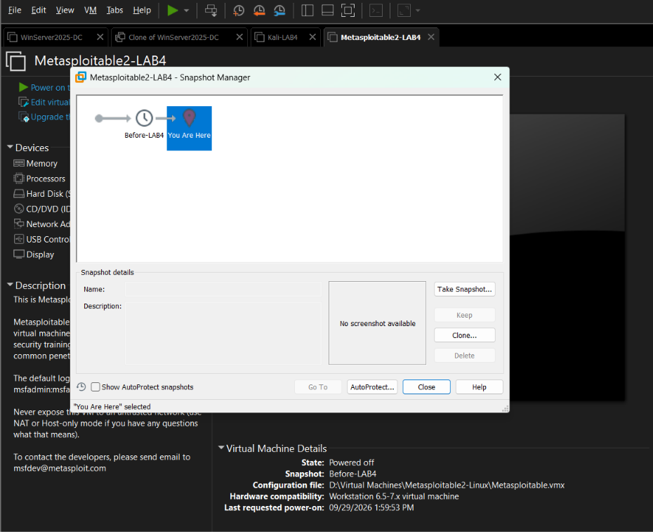

*Hình 4.1e – Snapshot “Before-LAB4” của Metasploitable2-LAB4.*

### 4.4. Lấy IP từng máy và kiểm tra kết nối

**Thực hiện** (mục 4.2 – 4.3 trong báo cáo):

```bash
# Trên Kali
ip -br addr
ip route
ping -c 4 192.168.56.130

# Trên Metasploitable 2
ifconfig
```

**Kết quả:**

| Thiết bị | IP thực tế | Subnet | Ghi chú |
| :-- | :-- | :-- | :-- |
| Windows Host | 192.168.56.1 | /24 | VMware Network Adapter VMnet1 – Hình 2.2 |
| Kali VM | 192.168.56.129 | /24 | Máy quét, eth0, IP do DHCP của VMnet1 cấp – Hình 4.2 |
| Metasploitable 2 | 192.168.56.130 | /24 | Máy đích, eth0, MAC 00:0c:29:fa:dd:2a – Hình 4.3 |

- `ip route` trên Kali chỉ có tuyến `192.168.56.0/24 dev eth0`, **không có default route** → Kali không còn đường ra Internet, NAT đã được ngắt.
- `ping -c 4 192.168.56.130`: 4 gói gửi, 4 gói nhận, **0% packet loss**, rtt trung bình 2.015 ms, ttl=64 (mặc định của Linux, phù hợp Metasploitable 2 chạy Ubuntu). Kết nối thông suốt nên chuyển sang bước quét, không cần `-Pn`.

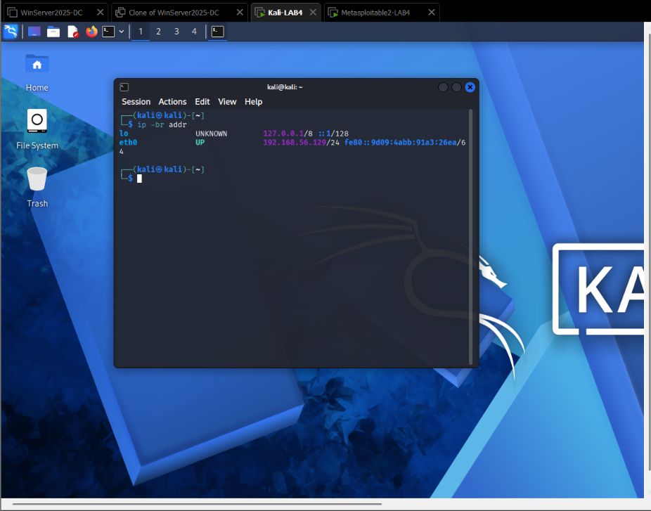

*Hình 4.2 – `ip -br addr` trên Kali: eth0 UP – 192.168.56.129/24.*

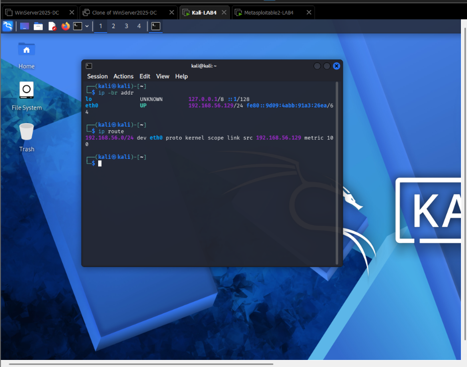

*Hình 4.2b – `ip route`: chỉ có tuyến 192.168.56.0/24, không có default route.*

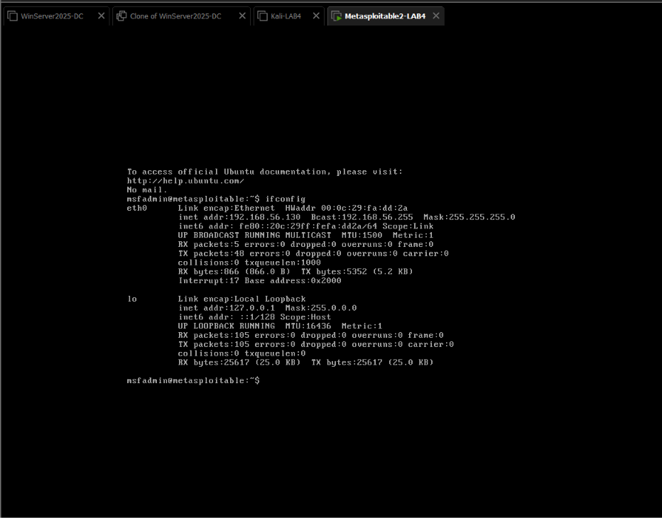

*Hình 4.3 – `ifconfig` trên Metasploitable 2: eth0 192.168.56.130, HWaddr 00:0c:29:fa:dd:2a.*

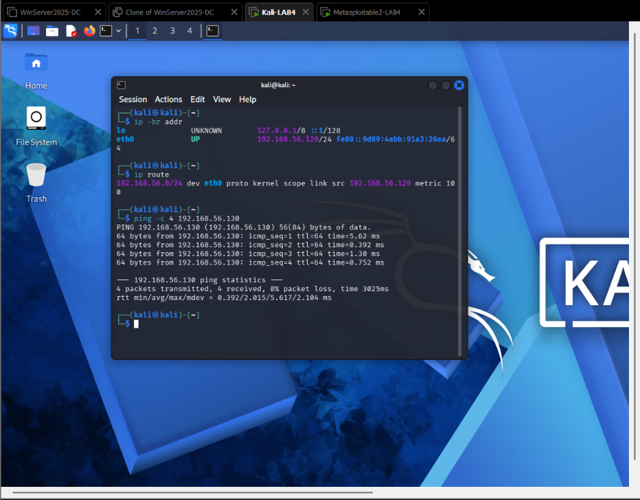

*Hình 4.4 – `ping -c 4 192.168.56.130` từ Kali: 0% packet loss.*

### 4.5. Phát hiện host đang hoạt động

**Thực hiện** (mục 5 trong báo cáo – tình huống Blue Team kiểm kê dải 192.168.56.0/24):

```bash
ip -br addr                              # xác nhận IP của chính máy quét
sudo nmap -sn 192.168.56.0/24            # host discovery toàn dải /24
sudo nmap -sn --reason 192.168.56.0/24   # thêm lý do Nmap kết luận host up
```

**Kết quả:** 256 địa chỉ được quét, **4 hosts up** trong 11.05 giây.

| STT | IP phát hiện | MAC / Vendor | Vai trò | Bằng chứng |
| :-: | :-- | :-- | :-- | :-- |
| 1 | 192.168.56.1 | 00:50:56:C0:00:01 / VMware | Adapter VMnet1 của máy Windows thật | arp-response, trùng IP ở Hình 2.2 |
| 2 | 192.168.56.129 | (không hiện – chính máy quét) | Kali Linux – máy quét | localhost-response, trùng IP ở Hình 4.2 |
| 3 | 192.168.56.130 | 00:0C:29:FA:DD:2A / VMware | Metasploitable 2 – máy đích | arp-response, trùng IP và MAC ở Hình 4.3 |
| 4 | 192.168.56.254 | 00:50:56:E2:EC:7A / VMware | Dịch vụ DHCP ảo của VMware cho VMnet1 | arp-response, không phải VM nào |

**Nhận xét:**

- Chỉ bật 2 VM nhưng có 4 host up. Hai host dư là `.1` (adapter VMnet1 của máy thật) và `.254` (DHCP server ảo của VMware, do đã bật *Use local DHCP service*).
- Tiền tố MAC `00:0C:29` là MAC tự sinh cho card mạng máy ảo; `00:50:56` dành cho adapter của host và dịch vụ VMware → phân biệt được VM thật và thành phần hạ tầng.
- Chạy bằng root trong cùng mạng LAN, `-sn` dùng **ARP request** (lý do `arp-response`) nên phát hiện được cả host chặn ICMP. `-sn` chỉ tìm host, không quét cổng.

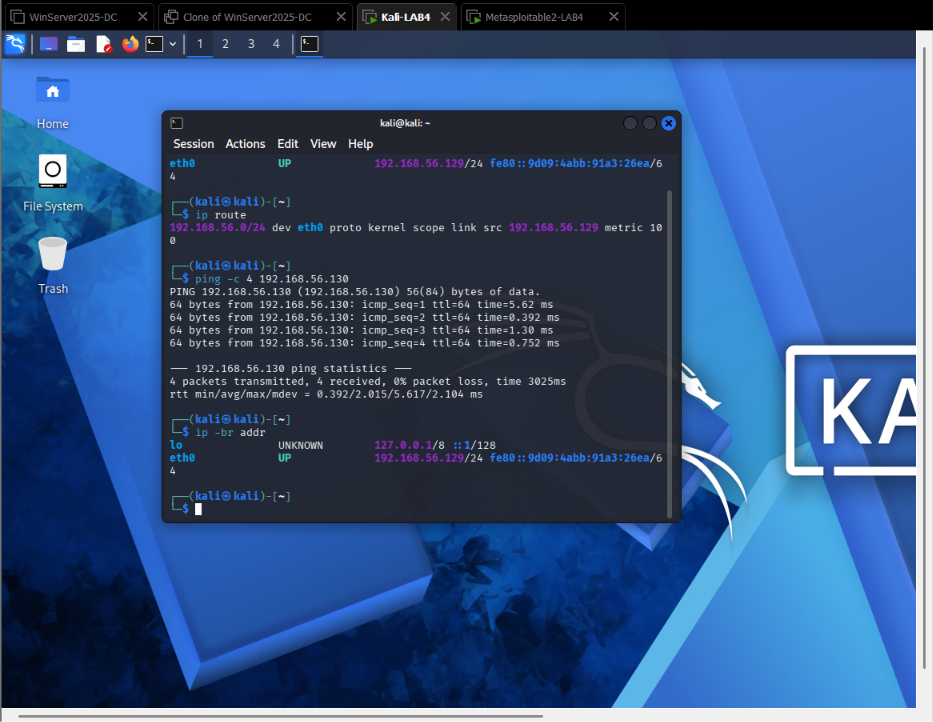

*Hình 5.0 – `ip -br addr`: máy quét Kali là 192.168.56.129/24 trên eth0.*

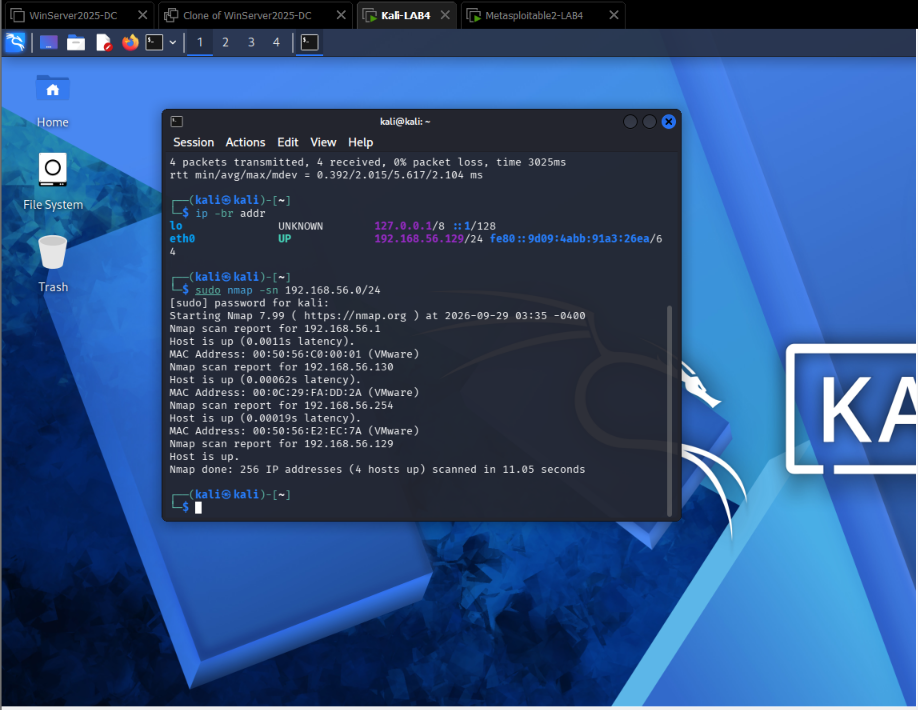

*Hình 5.1 – `sudo nmap -sn 192.168.56.0/24`: 256 IP addresses (4 hosts up) scanned in 11.05 seconds.*

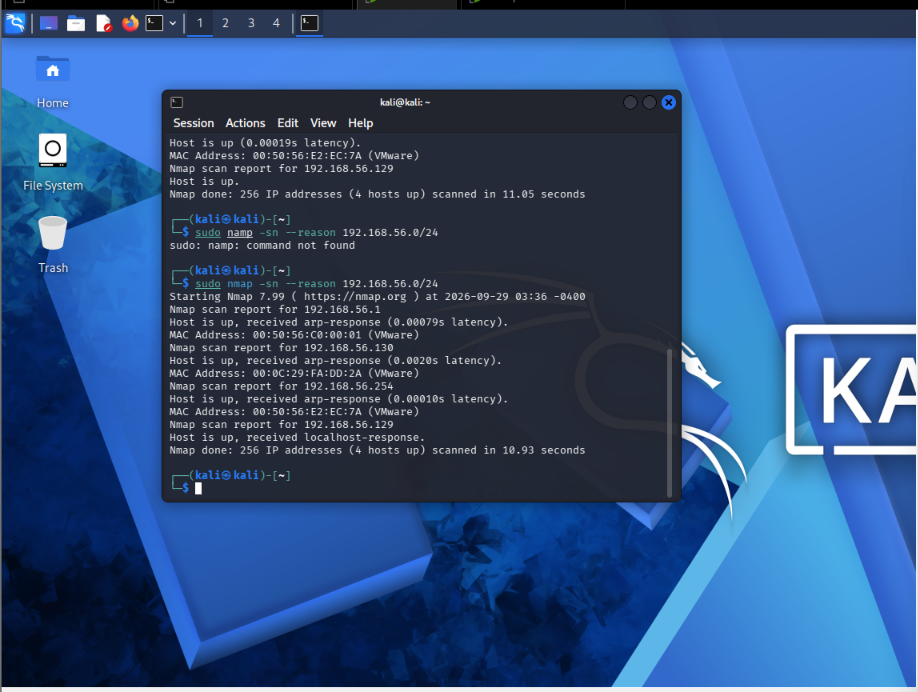

*Hình 5.1b – `sudo nmap -sn --reason 192.168.56.0/24`: cột lý do arp-response / localhost-response.*

### 4.6. Quét cổng TCP: -sT, -sS, -sF, -sA

**Thực hiện** (mục 6 trong báo cáo), tất cả nhắm vào máy đích 192.168.56.130:

```bash
nmap -sT 192.168.56.130                         # TCP Connect scan
nmap --unprivileged -sS 192.168.56.130          # thử SYN scan không có quyền root
sudo nmap -sS 192.168.56.130                    # SYN scan
sudo nmap -sF --reason 192.168.56.130           # FIN scan
sudo nmap -sA 192.168.56.130                    # ACK scan
```

**TCP Connect (-sT):** 23 open – 977 closed – 0 filtered trên 1000 cổng TCP phổ biến, 4.74 s. Các cổng open: 21 ftp, 22 ssh, 23 telnet, 25 smtp, 53 domain, 80 http, 111 rpcbind, 139 netbios-ssn, 445 microsoft-ds, 512 exec, 513 login, 514 shell, 1099 rmiregistry, 1524 ingreslock, 2049 nfs, 2121 ccproxy-ftp, 3306 mysql, 5432 postgresql, 5900 vnc, 6000 X11, 6667 irc, 8009 ajp13, 8180 unknown. `-sT` gọi hàm `connect()` của hệ điều hành, kernel tự bắt tay đủ 3 bước nên người dùng thường cũng chạy được.

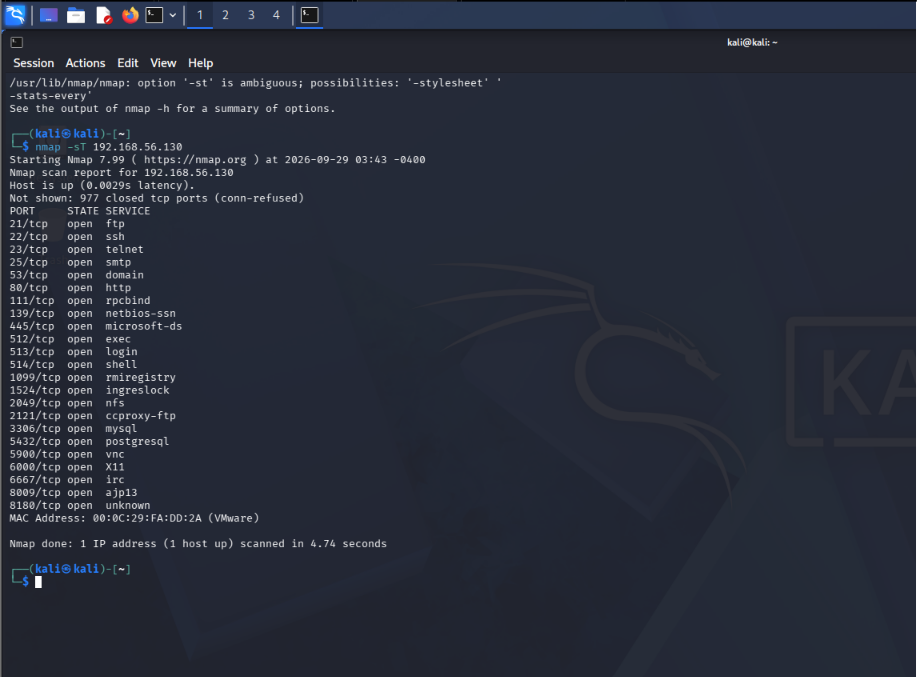

*Hình 6.1 – `nmap -sT 192.168.56.130`: 23 open, 977 closed (conn-refused).*

**SYN scan (-sS):** `cat /usr/bin/nmap` cho thấy trên Kali, `/usr/bin/nmap` là script bọc tự thêm `--privileged`. Khi ép chạy như người dùng thường bằng `--unprivileged -sS`, Nmap báo *You requested a scan type which requires root privileges. QUITTING!* → `-sS` cần quyền root (hoặc CAP_NET_RAW). Chạy bằng `sudo` thì cho 23 open, 977 closed (reset), 4.77 s.

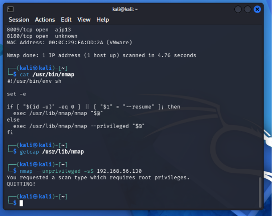

*Hình 6.2a – `nmap --unprivileged -sS` bị từ chối: requires root privileges.*

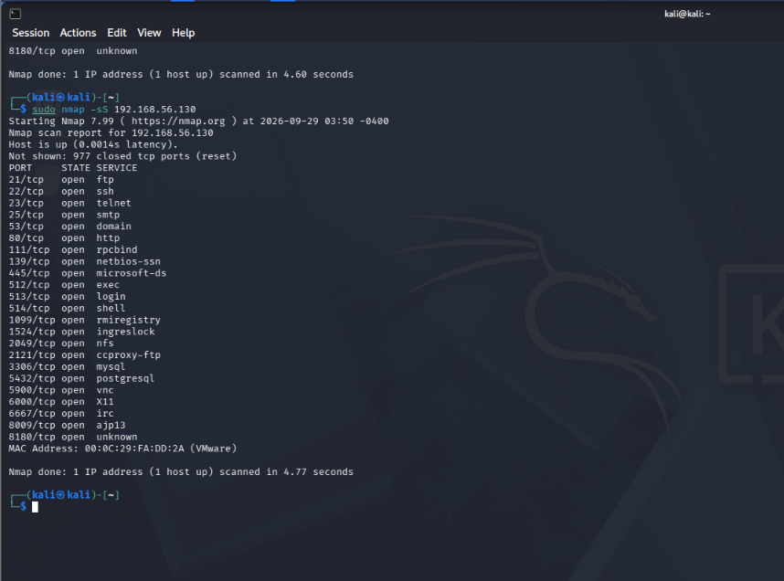

*Hình 6.2 – `sudo nmap -sS 192.168.56.130`: 23 open, 977 closed (reset), 4.77 s.*

| Tiêu chí | -sT | -sS | Nhận xét |
| :-- | :-: | :-: | :-- |
| Cổng open | 23 | 23 | Trùng hoàn toàn danh sách 23 cổng (21 → 8180) |
| Cổng closed | 977 (conn-refused) | 977 (reset) | -sT thấy connect() bị từ chối, -sS thấy trực tiếp gói RST |
| Cổng filtered | 0 | 0 | Metasploitable 2 không bật firewall |
| Thời gian | 4.74 s | 4.77 s | Gần bằng nhau vì mạng ảo độ trễ thấp và chỉ 1000 cổng |
| Quyền cần thiết | Người dùng thường | root / CAP_NET_RAW | `--unprivileged -sS` bị từ chối (Hình 6.2a) |

**FIN scan (-sF):** 23 cổng **open|filtered** (lý do no-response) và 977 closed (reset), 6.12 s. 23 cổng open|filtered trùng đúng 23 cổng open của `-sS`. Theo RFC 793, gói chỉ có cờ FIN tới cổng đóng thì nhận RST, tới cổng mở thì bị bỏ qua. “Không trả lời” cũng có thể do firewall chặn, nên chỉ nhờ đối chiếu với `-sS` (0 filtered) mới kết luận các cổng im lặng là cổng mở.

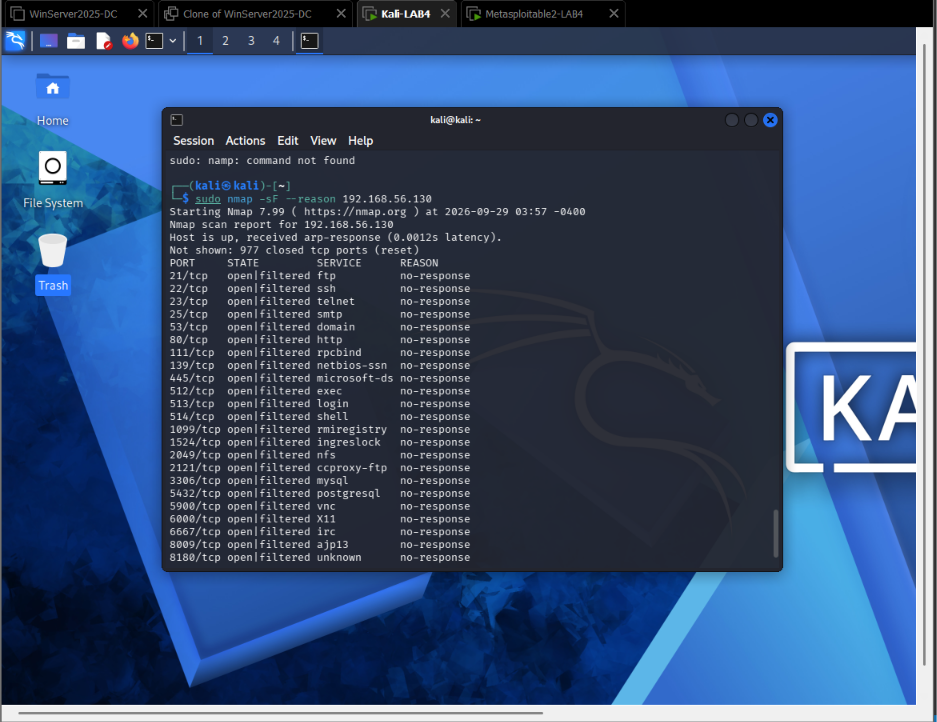

*Hình 6.3 – `sudo nmap -sF --reason 192.168.56.130`: 23 open|filtered, 977 closed.*

**ACK scan (-sA):** *All 1000 scanned ports are in ignored states. Not shown: 1000 unfiltered tcp ports (reset)*, 4.80 s. ACK scan không cho biết cổng mở hay đóng (gói ACK lạ luôn bị trả RST), mà cho biết gói có đi qua bộ lọc không. 1000 unfiltered → giữa Kali và Metasploitable 2 không có firewall lọc TCP, khớp với việc `-sT` và `-sS` không có cổng filtered.

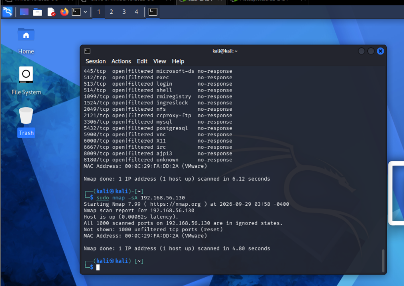

*Hình 6.6 – `sudo nmap -sA 192.168.56.130`: 1000 unfiltered tcp ports (reset).*

### 4.7. Quét UDP 20 cổng phổ biến

**Thực hiện** (mục 7 trong báo cáo):

```bash
sudo nmap -sU --top-ports 20 192.168.56.130            # lần 1
sudo nmap -sU --top-ports 20 --reason 192.168.56.130   # lần 2, có cột REASON
```

**Kết quả lần 2:**

| Cổng UDP | Trạng thái | Dịch vụ | Giải thích |
| :-- | :-- | :-- | :-- |
| 53/udp | open | domain (DNS) | udp-response: dịch vụ DNS trả lời gói thăm dò |
| 137/udp | open | netbios-ns | udp-response: Samba nmbd trả lời |
| 68, 69, 138/udp | open\|filtered | dhcpc, tftp, netbios-dgm | no-response: không có phản hồi UDP và cũng không có ICMP port unreachable |
| 15 cổng còn lại | closed | dhcps, ntp, msrpc, snmp, … | port-unreach: host trả ICMP port unreachable |

**Nhận xét:** lần 1 (12.21 s) có thêm 5 cổng (67, 139, 161, 500, 631) bị báo open|filtered, nhưng lần 2 (19.92 s) là closed. Nguyên nhân là Linux giới hạn tốc độ gửi ICMP port unreachable (khoảng 1 gói/giây); lần 2 Nmap chờ lâu hơn nên nhận đủ ICMP. Bài học: với UDP, “không trả lời” có thể là cổng mở, bị firewall chặn hoặc ICMP bị giới hạn tốc độ, nên cần `--reason`, quét lặp lại hoặc `-sV` trước khi kết luận.

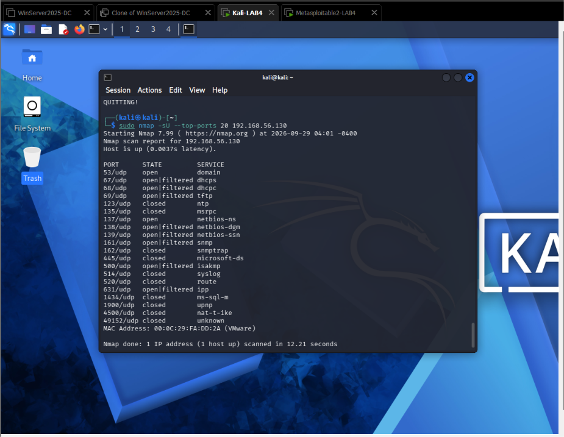

*Hình 7.1 – Lần 1: `sudo nmap -sU --top-ports 20 192.168.56.130` – 12.21 s.*

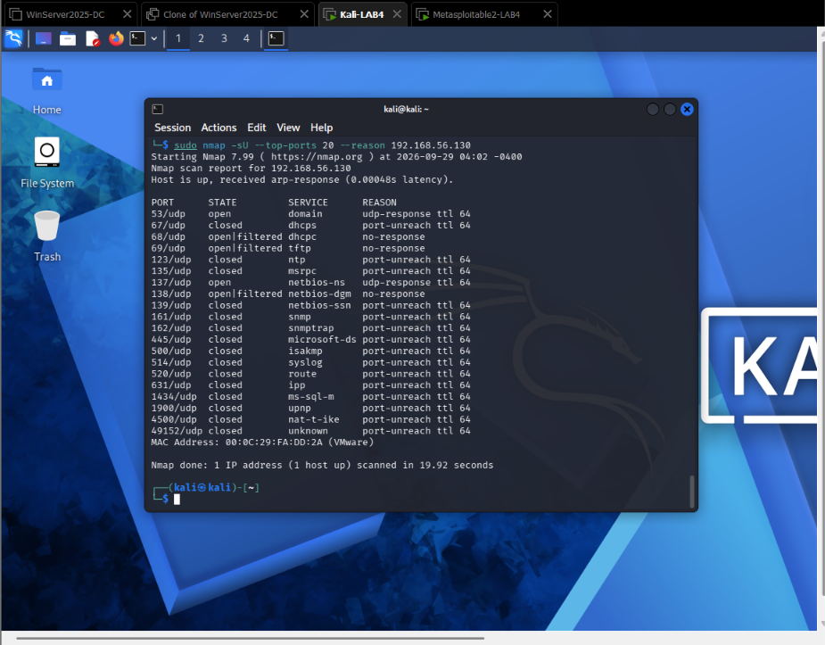

*Hình 7.1b – Lần 2: `sudo nmap -sU --top-ports 20 --reason 192.168.56.130` – 19.92 s, có cột REASON.*

### 4.8. Nhận diện dịch vụ, hệ điều hành, NSE và xuất kết quả

> **Lưu ý:** mục 8 – 10 trong báo cáo **không kèm ảnh chụp màn hình**. Số liệu dưới đây là kết quả chuẩn khi quét Metasploitable 2 (ghi chú như trong báo cáo); phần phân tích chi tiết nằm trong file Word.

| Mục | Lệnh | Kết quả / phân tích |
| :-- | :-- | :-- |
| 8.1 Version detection | `sudo nmap -sV 192.168.56.130` | vsftpd 2.3.4, OpenSSH 4.7p1, Apache 2.2.8, Samba smbd 3.X – 4.X, MySQL 5.0.51a, bindshell 1524/tcp, UnrealIRCd, ProFTPD 1.3.1, PostgreSQL 8.3.x, VNC 3.3, Apache Tomcat (8180/tcp) |
| 8.2 OS detection | `sudo nmap -O 192.168.56.130` | Linux 2.6.X (2.6.9 – 2.6.33), cách 1 hop |
| 8.3 Aggressive scan | `sudo nmap -A 192.168.56.130` | -A = -sV + -O + traceroute + script mặc định; nhiều thông tin nhưng tạo nhiều lưu lượng, dễ bị IDS phát hiện |
| 9.1 NSE | `sudo nmap -p 445 --script smb-os-discovery 192.168.56.130` | Unix (Samba 3.0.20-Debian), metasploitable.localdomain |
| 9.2 NSE | `sudo nmap -p 445 --script smb-vuln-ms17-010 192.168.56.130` | Không trả kết quả → không có dấu hiệu MS17-010 (lỗi SMBv1 của Windows); không kết luận “đã vá” |
| 10. Xuất kết quả | `-oN`, `-oX`, `-oG` + `grep`, `xsltproc` | So sánh 4 định dạng: text cho người đọc, XML cho công cụ khác, grepable để lọc nhanh, HTML để trình bày |

## 5. Đánh giá rủi ro và khuyến nghị

| Mức | Dịch vụ | Rủi ro | Khuyến nghị |
| :-- | :-- | :-- | :-- |
| Rất cao | 1524/tcp bindshell | Shell root mở sẵn, không cần xác thực | Gỡ dịch vụ, chặn cổng, rà soát toàn vẹn hệ thống |
| Rất cao | vsftpd 2.3.4, Samba 3.0.20, UnrealIRCd | Backdoor / thực thi lệnh từ xa (CVE-2011-2523, CVE-2007-2447, CVE-2010-2075) | Nâng cấp hoặc gỡ bỏ, tắt “username map script”, tắt SMBv1 |
| Cao | Telnet 23, FTP 21, r-services 512 – 514 | Truyền tài khoản và dữ liệu dạng rõ, đăng nhập dựa trên tin cậy host | Tắt dịch vụ, thay bằng SSH/SFTP dùng khóa |
| Cao | MySQL 3306, PostgreSQL 5432, SMB 139/445, NFS 2049 | Dữ liệu và thư mục chia sẻ mở ra toàn mạng | Firewall default-deny, CSDL chỉ bind 127.0.0.1, giới hạn share/export |

## 6. Trả lời câu hỏi phân tích

Tóm tắt câu trả lời; bản đầy đủ nằm ở mục 12.2 và 14.3 của file báo cáo.

<details>
<summary>Câu 1 – 10 (mục 12.2)</summary>

1. **open / closed / filtered:** open là có dịch vụ lắng nghe, trả SYN/ACK (21, 22, 80 trên Metasploitable 2 – Hình 6.2). closed là host trả RST nhưng không có dịch vụ (977 cổng còn lại, ví dụ 443). filtered là gói bị bộ lọc chặn, không phản hồi hoặc nhận ICMP *administratively prohibited* (ví dụ Windows Firewall chặn 445). Bài lab không có cổng filtered vì Metasploitable 2 không bật firewall (Hình 6.6).
2. **-sS cần quyền cao hơn -sT:** -sS tự tạo gói TCP thô chỉ có cờ SYN và tự bắt gói trả lời nên cần raw socket (root/CAP_NET_RAW, hoặc Administrator + Npcap). -sT chỉ gọi `connect()`. -sT bắt tay đủ SYN → SYN/ACK → ACK; -sS là nửa mở SYN → SYN/ACK → RST. Minh chứng: Hình 6.2a và 6.2.
3. **FIN/Xmas/NULL khó diễn giải:** dựa vào quy tắc RFC 793, nhưng Windows và một số thiết bị trả RST cho mọi cổng; “không trả lời” vừa có thể là cổng mở vừa có thể là firewall drop nên chỉ ghi được open|filtered; firewall stateful drop mọi gói lạ. Trong lab phải đối chiếu với -sS mới kết luận được (Hình 6.3).
4. **ACK scan khác SYN scan:** SYN scan hỏi “cổng có mở không”; ACK scan hỏi “gói có qua được bộ lọc không” (filtered/unfiltered), dùng để lập bản đồ luật firewall. Lab: 1000 unfiltered (Hình 6.6).
5. **UDP chậm và hay open|filtered:** UDP không bắt tay; cổng mở thường im lặng, firewall drop cũng im lặng; Nmap phải chờ hết thời gian và gửi lại; Linux giới hạn ICMP port unreachable. Lab: lần 1 có 8 cổng open|filtered, lần 2 chờ lâu hơn chỉ còn 3 (Hình 7.1, 7.1b).
6. **Vai trò của -sV:** xác định đúng sản phẩm và phiên bản để tra CVE, ưu tiên vá và kiểm tra lại sau khi vá. “80/tcp open http” chỉ là đoán theo số cổng; ví dụ 8180 chỉ hiện unknown, phải -sV mới biết là Tomcat, còn cổng 21 thực chất là vsftpd 2.3.4 có backdoor.
7. **Giới hạn của -O:** cần cả cổng mở và cổng đóng; firewall, NAT, proxy có thể sửa hoặc tự trả lời gói; máy ảo, kernel tùy biến, cơ sở dữ liệu thiếu OS mới, mất gói hay giả mạo đều làm sai lệch → chỉ là giả thuyết, phải đối chiếu với -sV, smb-os-discovery, TTL.
8. **NSE timeout không có nghĩa là không có lỗ hổng:** timeout chỉ là không nhận đủ phản hồi (mất gói, firewall, cần xác thực…) → kết quả là “không xác định”; cần kiểm tra lại cổng, tăng `--script-timeout` hoặc kiểm tra bản vá trực tiếp.
9. **Before/after hardening:** cùng lệnh, cùng máy quét, cùng mục tiêu; cổng của dịch vụ được xử lý chuyển open → closed (đã tắt dịch vụ) hoặc open → filtered (firewall drop), hoặc VERSION chuyển sang bản đã vá, trong khi cổng nghiệp vụ vẫn open.
10. **Ba cấu hình giảm bề mặt tấn công:** tắt dịch vụ không cần (Telnet, r-services, 1524, X11, VNC); firewall default-deny, CSDL chỉ bind 127.0.0.1, SMB chỉ trong LAN; vá lỗi, tắt SMBv1, bỏ mật khẩu mặc định, SSH dùng khóa. Đổi cổng hay giấu banner chỉ là “ẩn mình”.

</details>

<details>
<summary>Câu 11 – 14 (mục 14.3)</summary>

11. **Quét 65535 cổng tốn thời gian:** gấp khoảng 65 lần số cổng, mỗi cổng im lặng phải chờ hết thời gian, host giới hạn tốc độ RST/ICMP. Cần quét đầy đủ khi nghiệm thu máy chủ, kiểm thử có ủy quyền, nghi có backdoor ở cổng lạ hoặc xác nhận hiệu quả hardening.
12. **Decoy (-D) và fragmentation (-f):** -D chèn gói với IP nguồn giả để che IP thật; -f chia nhỏ header TCP để qua mặt bộ lọc không ghép mảnh. Phòng thủ: ghép mảnh và chuẩn hóa gói trước khi kiểm tra, chống giả mạo IP (ingress/egress filtering, uRPF), tương quan TTL/MAC, firewall default-deny, cảnh báo theo hành vi quét.
13. **Lợi ích của -oA:** một lần quét sinh 3 tệp nhất quán: `.nmap` cho người đọc, `.xml` cho công cụ khác hoặc chuyển HTML, `.gnmap` để grep; có dòng lệnh và thời gian để lặp lại, có thể tính hash để chứng minh toàn vẹn.
14. **Toàn bộ cổng filtered:** host hoặc thiết bị phía trước có firewall mặc định chặn và DROP im lặng, không có luật cho nguồn quét (hoặc chỉ cho một số IP). Nên kiểm tra thêm bằng ACK scan và chắc chắn host đang sống trước khi kết luận, vì `-Pn` vào host đang tắt cũng ra toàn filtered.

</details>

## 7. Mức độ hoàn thành

| Phần | Trạng thái |
| :-- | :-- |
| Mục 2 – 7: cài đặt Nmap, dựng môi trường, host discovery, quét TCP (-sT, -sS, -sF, -sA), quét UDP | Đã làm, có ảnh minh chứng (26 ảnh) |
| Mục 8 – 10: -sV, -O, -A, NSE, xuất kết quả | Có phân tích trong báo cáo, không có ảnh chụp màn hình |
| Mục 12.2 (10 câu) và 14.3 (4 câu) | Đã trả lời |
| Bài tập 14.1 câu 1, 3, 4, 6 và tình huống 14.2 (bản đồ dịch vụ) | Đã làm, dựa trên số liệu các mục trên |
| Xmas / NULL scan | Chưa thực hiện |
| Mục 11: so sánh trước / sau hardening | Chưa thực hiện |
| Bài tập 14.1 câu 2 (quét 65535 cổng) và câu 5 (decoy) | Chưa thực hiện |
| Windows VM (tùy chọn) | Không dựng |

## 8. Cấu trúc thư mục

```
LAB04_AT-BMHTTT/
├── README.md                                          # tệp này
├── 1150080095_HuynhHuuHoang_11CNPM2_BAOCAO_Word.docx  # báo cáo chính
└── images/                                            # 26 ảnh minh chứng (trích từ báo cáo, đặt tên theo số hình)
```

## 9. Ghi chú

- Tài liệu hướng dẫn viết cho VirtualBox; bài làm dùng VMware Workstation, mạng VMnet1 Host-only tương đương. IP do DHCP của VMware cấp (.129, .130) nên khác sơ đồ mẫu (.10, .101).
- Phạm vi đạo đức: chỉ quét các máy ảo do chính sinh viên dựng trong mạng Host-only; không quét IP hoặc tên miền bên ngoài.
